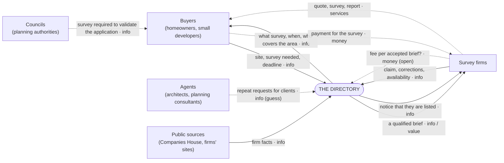

# Product brief (draft, 2026-10-23)

**The map is `model/`** (see `AGENTS.md`). This brief is the narrative and the reasons. Where the two differ, `model/` wins, and the brief is corrected.

**Status: draft for the principal.** Nothing here is decided unless it cites the principal. Guesses are marked *(guess)* and every open question is listed in §8. The code (cb2de38) was built before this brief and will be changed to match it, not the other way round.

Method: modelkit's ladder (`D:/PROJECTS/modelkit/docs/proposals/modelkit.md`), business first:
- level 0, context;
- level 1, business use cases;
- level 2, stages;
- level 3, processes (BPMN, later).

Each view shows about five things. No technology appears above §6.

**Sources**, cited by short name:

| Short name | What it is |
|---|---|
| **P** | The principal, this session, 2026-10-23 |
| **S7** | Buyer demand, callsheet `docs/screens/s7-env-buyer-demand/result.md` |
| **S9** | Survey sellers, callsheet `docs/screens/s9-env-supply/result.md` |
| **S10** | Seed fact-check, callsheet `docs/screens/s10-seed-factcheck/result.md` |
| **A6, A7** | Logged guesses, callsheet `docs/assumptions.md` |

---

## 1. Why this business

- **Demand exists.** Buyer-phrased searches for planning surveys come to about 14,800 a month. The largest are "bat survey", "flood risk assessment" and "environmental impact assessment" (S7).
- **Supply is small and findable.** About 230–410 firms in SIC 74901 sell planning surveys and have a website (S9). More sit under other codes (acoustics, engineering, arboriculture).
- **The ask is plain, from P:**
  - "id rather show and tell. lets build it"
  - "a porsche macan with snow treads": small, fast, built for rough ground.
  - Scope: "All planning surveys" (chosen option).
- **Not a listings business.** Paid uptake of directory listings is about 3% (S10, The Knowledge). The money in comparable trades is in leads and intelligence (S10; A7, a guess).

## 2. Level 0: context

**System of interest:** the directory business, meaning the service and its operator (the principal).
- **Why the box sits here:** it is what we build and run (P: "build it").
- **Inside the box:** the operator, so the operator's work is the system's work, not a use case.

**Findings at level 0:**
- **Flows outside the box (warning W7, kept on purpose).** The council → buyer and firm ⇄ buyer flows don't pass through us.
  - The council creates the need.
  - The firm and buyer transact directly.
  - So we earn nothing on the job itself unless the business model reaches into that flow.
- **Agents are a guess.** Architects and planning consultants commission surveys on clients' behalf, repeatedly. If that's true, they are the repeat buyer and possibly the main channel. Untested.
- **Money from firms is the open flow.** See §5.

## 3. Level 1: business use cases (what each party comes to us for)

| Party | Comes to us to… | Status |
|---|---|---|
| Buyer | **U1** Find out which survey I need, and when it can be done | built (survey pages) |
| Buyer | **U2** Get the survey done in time for my application | part: request stored, nothing routed |
| Agent *(guess)* | **U3** Get several surveys quoted for one site, quickly | missing |
| Firm | **U4** Get the enquiries I want, and not the ones I don't | missing (the core) |
| Firm | **U5** Keep my listing right, or have it removed | part: claim stored, no edit or removal |

**Councils** come to us for nothing. They set the requirement (finding: an actor outside our use cases).

**The system's own aims,** kept on the boundary, not as use cases:
- earn money (§5);
- grow and keep a correct list of firms;
- stay lawful (listing notices, removal, retention).

## 4. Level 2: stages

**U2, "Get the survey done in time", for the buyer.** We cover stages 1–3. Stages 4–5 happen between buyer and firm.

| 1. Learn what's needed | 2. Find who covers it | 3. Ask for quotes | 4. Choose and book | 5. Survey and report |
|---|---|---|---|---|
| Read what the survey is and its season | See firms for the survey and region | Describe the site once | Compare replies | Firm visits, reports |
| built | built | stored only | outside | outside |

**U4, "Get the enquiries I want", for the firm.**

| 1. Be found | 2. Get a brief | 3. Decide | 4. Quote | 5. Win or lose |
|---|---|---|---|---|
| Listing exists, claimed or not | See survey, area, deadline, site | Accept or decline; pause when booked up | Reply to buyer | Tell us? |
| built | missing | missing | outside | missing (we can't learn without it) |

**Stage U4.3 is the product.** Firms may be capacity-constrained in survey season (A6). An enquiry they can't take is worth nothing to them; one that fits their survey, area, season and timetable is worth a lot.

## 5. Business model

**Decided (P, 2026-10-23): "yeah fuck it M1. we'll take in leads and qualify them. we'll build a qualification system."**
- Firms pay per brief they choose to unlock.
- Every lead is qualified before any firm sees it (§5a).
- Price and timing are still open: free until briefs flow, then priced from the calls (§9).

The options as they were put:

| Option | Who pays | For what | For | Against |
|---|---|---|---|---|
| **M1 Pay per accepted brief** *(recommended to test)* | Firm | To unlock the buyer's contact after seeing the brief | Pays only for work it wants (fits A6). Matches where the money is (A7). | Lead sites have a bad name with trades: briefs must be real and exclusive enough. Needs volume. |
| M2 Listing subscription | Firm | Visibility, priority | Simple; what 4rfv and The Knowledge do | About 3% uptake (S10); it's the model we set out not to copy |
| M3 Buyer pays | Buyer | A matched shortlist, or a "which surveys do I need" check | Buyer's pain is acute (deadline, refusal risk) | One-off buyers, free alternatives (council lists, Google) |
| M4 Commission on job won | Firm | % of the survey fee | Aligned with value | Hard to see or enforce; needs U4.5 |

## 5a. Qualification

**Why it exists:** under M1 a firm pays for a brief, so a bad brief is a refund and a lost firm. Firms will judge "worth answering" on the four things the call guide listens for in Q5 (S8 method):
- **Real:** a planned job with a planning purpose.
- **Serious:** a reachable person who means it.
- **Timely:** the deadline fits the survey's season.
- **Complete:** a firm can price it without a phone call.

These four are the first guess at the criteria *(guess: confirmed or changed by the calls, §9)*.

| Check | What it asks | How | Fails → |
|---|---|---|---|
| **Real** | What's planned (extension, loft, barn conversion, new build, demolition, change of use, other), the planning stage, and whether the council has asked for this survey | Intake questions; council reference format if given | not a fit (no planning purpose) |
| **Serious** | Is the person reachable? | Email confirmed by link; phone given | waiting (unconfirmed) |
| **Timely** | Can the survey be done by the deadline, given its season? | Deadline vs the survey's season months (catalogue) | flagged: "can't start until May" is told to the buyer at once, and the lead still goes out with the flag |
| **Complete** | Is there enough to price it? | Full site postcode, site description, and survey-specific details (e.g. for bats: building age, roof type) | needs info (buyer asked for the missing piece) |

**Grades:**
- **qualified:** all four pass.
- **needs info:** fixable by the buyer.
- **not a fit:** no planning purpose, or a survey we don't list.

**The operator reviews every qualified lead before it is offered.** This is the default for now: routing by hand teaches what to automate (§8, Q4).

**Buyer value, built in.** Telling the buyer straight away that their deadline misses the season (bat activity surveys run only May–September) is useful to them even when no firm can help. It also stops firms paying for impossible jobs.

**Recommendation as put:** free for everyone until briefs flow, then test M1 on the calls. Prices are unknown: no source yet.

## 6. Business objects and their lifecycles

The things the business tracks. Software comes later, from these.

| Object | States | Notes |
|---|---|---|
| **Listing** (a firm) | unclaimed → claim pending → claimed → paused ⇄ claimed · removed | Built from public sources; removed on request, never re-added (tombstone) |
| **Lead** (a buyer's need) | received → confirmed (email) → qualified / needs info / not a fit → approved (operator) → offered → closed / expired | One site, one survey (or several: U3). Graded by §5a. |
| **Brief** (a request offered to one firm) | offered → accepted / declined / lapsed → quoted → won / lost | The unit of value under M1 |
| **Claim** | submitted → confirmed / rejected | Proof: email on the firm's own domain |
| **Notice** (to a listed firm) | due → sent → acknowledged / objected | Article 14 duty for data not collected from them |

**Built today:**
- **Listing:** no states yet.
- **Lead:** received → confirmed → graded → approved or rejected (24329bf). Offering it to firms is not built.
- **Claim:** stored only.
- **Brief, Notice:** not built.

## 7. Processes (level 3 candidates, BPMN later)

1. **Qualify a lead.** Received → email confirmed → four checks (§5a) → graded → operator approves. Built first.
2. **Route a lead.** Approved → match firms by survey, region and availability → offer briefs → chase or lapse → tell the buyer. First to map: it's the core and undefined. Open questions:
   - how many firms per request;
   - how long a firm has to respond;
   - what the buyer is told if nobody takes it.
3. **Claim a listing.** Request → email link → confirmed → edit.
4. **Add firms.** vein candidates → site check (S9 rule) → survey and region mapping → notice → listed.
5. **Correct or remove.** Request → check → apply → tombstone.
6. **Retain.** Delete buyers' personal data on a schedule (period open).

## 8. Open questions for the principal

1. **Business model:** M1, decided (§5). Still open: free until when, and the price.
2. **Agents:** treat architects and planning consultants as a primary buyer (U3)?
3. **Routing:** how many firms per request (3?), and who chooses: us, or the buyer?
4. **Operator load:** routing by hand at first? (It fits "show and tell", and tells us what to automate.)
5. **Name and brand:** "Survey Finder" is a placeholder.
6. **Going public:** hosting, privacy notice, listing notices and the legal entity. Callsheet's #2–#8 are parked (log 000071) and come back if this goes live.

## 9. What the calls must now test (S8, revision 3 before any demo call)

Show the firm its own listing and one sample brief. Then record:
- **`wants_briefs`:** would they accept briefs like this? Which ones would they decline, and why?
- **`capacity`:** are they booked up in season? Would pausing matter?
- **`m1_price`:** what would unlocking that brief be worth? Stated price, and per what.
- **`agents`:** how much of their work comes through architects or consultants?
- **`committed`:** claims the listing on the call, or names another firm to call.

**The decision rule is to be written and committed before the first demo call.**
