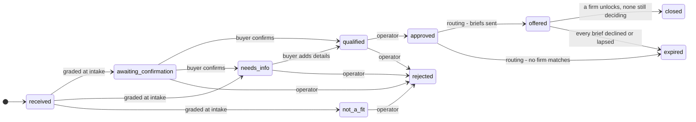
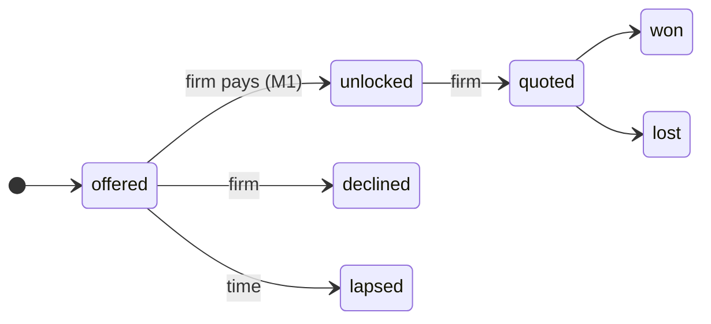
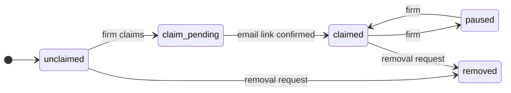
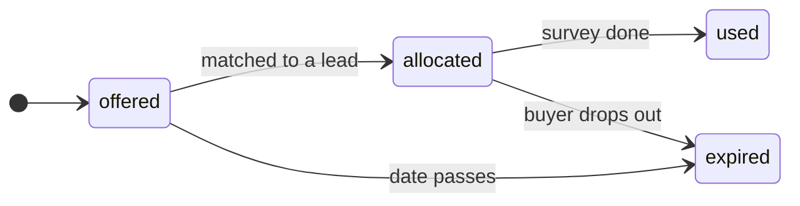
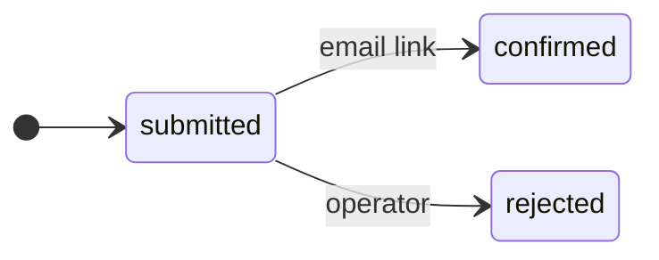
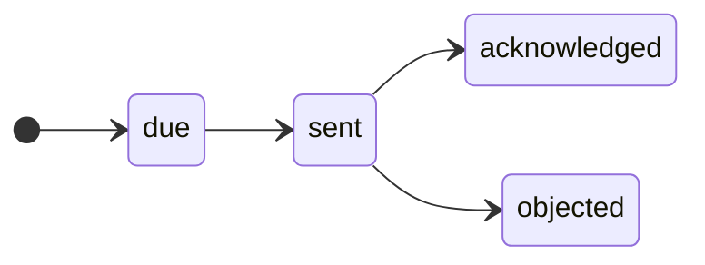

# The map (generated from `model/` by `npm run model:views`; do not edit)

Read top-down: **why** (D, PN) → **who** (P, CH, ALT) → **what** (U, ST) → **how** (PR, O) → code. Every line cites its D, R or Q.

## Why: decisions

| id | decision | said | rests on |
|---|---|---|---|
| D1 | Domain: a UK directory of planning-survey firms, built lean in its own repo | "callsheet is huge. like a cathedral. i want a porsche macan with snow treads baby (chose: New lean repo; All planning surveys)" (2026-10-23) | R0/S7, R0/S9, R0/S10 |
| D2 | Business model M1: firms pay per brief they unlock; every lead is qualified first | "yeah fuck it M1. we'll take in leads and qualify them. we'll build a qualification system." (2026-10-23) | R0/S10 |
| D3 | We work from models: map first, territory follows, map updated | "models are the map. we build the territory, and the maps are updated to reflect. it's a tight, closed, loop." (2026-10-23) | principal |
| D4 | Claims need receipts; a map is not evidence | "you have a bad habit of believing the the maps say i want cold hard receipts." (2026-10-23) | principal |
| D5 | Sell firms intelligence on where and when demand is coming | "4. okay, GOOD! LETS DO THAT TOO" (2026-10-23) | R2 |
| D6 | Firms can pay in kind with spare survey capacity | "5. GOOOD LETS DO THAT TOO" (2026-10-23) | R2 |
| D7 | Delegation demands evidence up front | "who the FUCK sends out their asisstants to do something and NOT ASK FOR EVIDENCE?" (2026-10-23) | R3 |
| D8 | A clear, traceable, business-driven information architecture; no bloat | "we need a clear hiearchal information architecture. traceable. clean, not stupid. business driven. i dont want it to bloat like the old callsheet." (2026-10-23) | principal |
| D9 | Threshold for M1, provisional: £100k a year at 5% capture | "threshold, yeah i guess. i dont know I DONT HAVE A FUCKING POINT OF REFERENCE YET DO I?" (2026-10-23) | R3, Q10 |
| D10 | Buyer pain points front and centre, synthesised, in design and in the model | "1. and on that note we need to hold those buyer pain points front and centre. but synthesized. add that to our design plans and model ideas." (2026-10-24) | R2, R4 |
| D11 | Business model first, then design around it for humans | "q12 yep - first we think about our business model then we design around it for humans." (2026-10-24) | R4 |
| D12 | Build the product now on the placeholder terms; the calls come later | "calls later. we build the product regardless. its not rocket science what we're building." (2026-10-24) | R6, Q15, Q16 |
| D13 | M1 at £99,417 a year (5% capture) is acceptable | "99,417 is acceptable" (2026-10-24) | R3, D9, Q10 |
| D14 | Show the journey on the site; problem first; answer before asking; say why for every detail; Mermaid now, brand skin later | "the user journey should be illustrated on the site. one annoyance from my point of view as a buyer is i dont know wtf im filling information for. they ask me for my name, why? my email and phone number, why?, address, why? what comes after? why cant i know now? why cant i say what my problem is first? its all annoying and backwardsa and breadcrumbed like im being tricked into a trap. can we like, use mermaid and later on stick on a visual skin tuned to our branding? (then, on the requirements read back: yes)" (2026-10-24) | D10, Q17 |
| D15 | Work management must survive sessions: nothing pending lives only in a chat; mirror the map to GitHub at the end of this session | "well do it at the end of this session. im concernw with our work management being lost and collapsing as sessions progress." (2026-10-24) | D3, D8 |

## Why: buyer pains (D10)

What buyers suffer today, synthesised from the sources; every design answers one of these.

| id | pain | sources | receipt | answered by |
|---|---|---|---|---|
| PN1 | A cheap first survey led to a large or doubtful follow-on bill | 14 (About 10 of the 14 are one national firm's reviews) | £1,306.80 first survey, then a £28,726.80 follow-on quote; an independent did it for £3,924 (R2) | Q4 |
| PN2 | The season cost me months, or a year | 8 | 'wait a year'; the 12-month wait used as a sales lever (R2) | U1, ST-U2.2, Q5 |
| PN3 | I can't find or hear back from a surveyor, or tell why they want my details and what happens next | 9 (The details-and-next-step half has one source, the principal; Q17 tests it) | 'the planning officer doesn't recommend anyone, so I'm at the mercy of Google' (R2); the professional body's directory leaves the buyer to contact practices one by one (R4); 'they ask me for my name, why? ... what comes after?' (the principal as a buyer, D14) | ST-U2.1, ST-U2.2, ST-U2.3, PR2, Q7, Q11, Q17 |
| PN4 | I found out at validation that I needed a survey | 7 | 'Only to be told I needed a bat survey' (R2) | U1, CH-validation, Q6 |
| PN5 | I didn't know whose report the council would accept | 4 | 'ask the council who they accept surveys from' (R2) | Q14 |

Aims on the boundary: A1 Earn money from firms (M1, plus intelligence and in-kind); A2 Grow and keep a correct list of firms; A3 Stay lawful: listing notices, removal, retention.

## Who: context

System of interest: **The directory** (the service, the operator (the principal)). It is what we build and run.

### Channels

| id | party | channel | status | receipt | rests on |
|---|---|---|---|---|---|
| CH-search | Buyers (homeowners, small developers) | Searches the survey the council asked for | part | 'bat survey', 'flood risk assessment', 'environmental impact assessment' each 1K-10K UK searches a month (S7); Arbtech in 14 of 23 searches (R1) | R0/S7, R1 |
| CH-validation | Buyers (homeowners, small developers) | Told by the council at validation that a survey is missing | missing | 'Only to be told I needed a bat survey'; 'the planning officer doesn't recommend anyone, so I'm at the mercy of Google' (R2 gap-buyer.md) | R2 |
| CH-agent | Agents (architects, planning consultants) | Architects and planning consultants pick or recommend the firm *(guess)* | missing | none yet | Q1 |
| CH-outbound | Survey firms | We find and contact firms from Companies House and their sites | part | 82% of CIEEM practices are active companies, 67% with SIC 74901; R3's rule kept 35% (micro-entity and age filters); no rule tested reaches 70% recall at a workable size (R5) | R0/S9, R3, R4, R5 |
| CH-body | Survey firms | Professional bodies' directories (CIEEM, ANC) | outside | CIEEM Registered Practice Directory: 169 UK practices, 145 offering a catalogue ecology survey, 134 bat surveys; firms pay £147-£3,140+VAT a year by headcount (R4) | R1, R4 |
| CH-peers | Survey firms | Firms pass overflow work to each other *(guess)* | missing | none yet | Q8 |

### Alternatives

| id | alternative | serves | offer | rests on |
|---|---|---|---|---|
| ALT-arbtech | Arbtech (national firm) | U1, U2 | Fixed published prices (bat roost £399+VAT), UK coverage, money-back guarantee; in 14 of 23 searches; also runs batsurveys.co.uk, ecologysurveys.uk, biodiversitynetgainplan.co.uk Receipt: Arbtech Consulting Ltd (05678552) accounts to 23 Sep 2024: turnover £10,841,715, profit before tax £4,483,055, 113 staff, 'over 13,800' assessments; 60% acquired by Celnor Group | R1, R2 |
| ALT-signed-off | Signed Off (signed-off.co.uk) | U1, U2, U5 | 'Which reports do I need?' checker (no postcode or council step), directory, quotes from up to 3; free and paid listings | R2 |
| ALT-planning-review | The Planning Review | U2 | Firms found on planning applications, with quotes; no checker | R2 |
| ALT-cieem | CIEEM Registered Practices Directory | U2, U5 | Search by postcode and distance, then filter by service, species and licence; contact each practice yourself (no enquiry form, no prices, no season); ecology only; firms pay £147-£3,140+VAT a year Receipt: 169 UK practices; within 25 miles: Bristol 22, London 18, Glasgow 12, Edinburgh 7, Belfast 1 (R4) | R1, R4 |
| ALT-worklanded | Worklanded | U4 | Bat and ecology leads sold to firms at £26 each, one firm at a time; 11 enquiries in 90 days | R1 |
| ALT-brokers | Small brokers (batsurveycost.co.uk, RenKap, Yell) | U2 | Pass one request to up to 3 firms; firm-side terms not published | R1 |

## What: use cases

| id | party | use case | status | rests on |
|---|---|---|---|---|
| U1 | Buyers (homeowners, small developers) | Find out which survey I need, and when it can be done | built | R2 |
| U2 | Buyers (homeowners, small developers) | Get the survey done in time for my application | part | D2, R3 |
| U3 | Agents (architects, planning consultants) | Get several surveys quoted for one site, quickly *(guess)* | missing | Q1 |
| U4 | Survey firms | Get the enquiries I want, and not the ones I don't | part | D2, Q2, Q3 |
| U5 | Survey firms | Keep my listing right, or have it removed | part | D1 |
| U6 | Survey firms | Know where and when demand is coming, so I can plan my season | missing | D5, D6 |

### Stages

**U2** Get the survey done in time for my application

| id | stage | outcome | status |
|---|---|---|---|
| ST-U2.1 | Tell us what's going on | The problem in my own words, and where the site is | built |
| ST-U2.2 | Find out what you need and when | Knows the survey, its season, a typical price and how many firms cover the area | built |
| ST-U2.3 | Choose whether to get quotes | Contact given knowing why; confirmed, checked and sent to up to 3 firms | built |
| ST-U2.4 | Pick a firm and book | A firm is booked | outside |
| ST-U2.5 | The survey and the report | Has the report for the council | outside |

**U4** Get the enquiries I want, and not the ones I don't

| id | stage | outcome | status |
|---|---|---|---|
| ST-U4.1 | Be found | Listed, claimed or not | built |
| ST-U4.2 | Get a brief | Sees survey, area, deadline, site; contact hidden | built |
| ST-U4.3 | Decide | Unlocked (pays) or passed; paused when booked up | part |
| ST-U4.4 | Quote | Buyer has the firm's quote | outside |
| ST-U4.5 | Win or lose | We know the outcome | missing |

## How: objects

### O-lead Lead (part; rests on D2)

### O-brief Brief (one lead offered to one firm) (part; rests on D2, Q3)

### O-listing Listing (a firm) (part; rests on D1)

### O-slot Slot (spare survey capacity, paid in kind) (missing; rests on D6)

### O-claim Claim (part; rests on D1)

### O-notice Notice (Article 14, to a listed firm) (missing; rests on D1)

## How: processes

| id | process | realises | steps | status | rests on |
|---|---|---|---|---|---|
| PR1 | Qualify a lead | U2 | Buyers (homeowners, small developers): Say the problem; see the answer; choose to send, giving contact last (built); The directory: Work out the area and the council from the postcode, so the buyer isn't asked twice (built); The directory: Grade on real, serious, timely, complete (built); Buyers (homeowners, small developers): Confirm by email (button press); no mail provider in production yet (Q21) (built); The directory: Operator approves or rejects (built) | built | D2, D14 |
| PR2 | Route a lead | U4 | The directory: Match firms by survey, region, availability (built); The directory: Offer briefs, contact hidden (built); Survey firms: Unlock (fee owed) or pass; pause when booked up (built); The directory: Lapse and tell the buyer (built); chase firms before lapse (missing) (part) | part | D2, D12, Q3, Q15, Q16 |
| PR3 | Claim a listing | U5 | Survey firms: Claim with an email on the firm's domain (built); The directory: Email a confirmation link (built); Survey firms: Edit the listing (missing) | part | D1 |
| PR4 | Add firms | U5 | The directory: Check candidates exist and are active in vein (Companies House) (missing); The directory: Take candidates from CIEEM's Registered Practice Directory (145 ecology practices), once CIEEM gives written permission (missing); The directory: Check the site sells planning surveys (part); The directory: Map surveys and regions (part); The directory: Send the listing notice (missing) | part | R0/S9, R3, R4, R5 |
| PR5 | Correct or remove a listing | U5 | Survey firms: Ask (missing); The directory: Apply and tombstone (missing) | missing | D1 |
