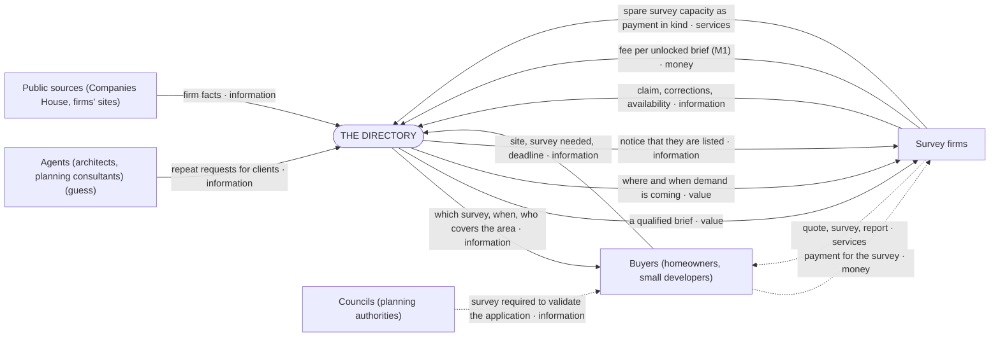
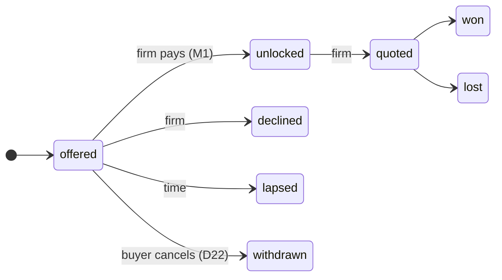
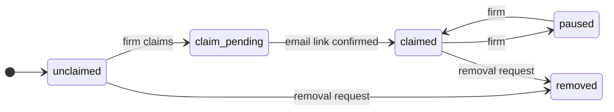
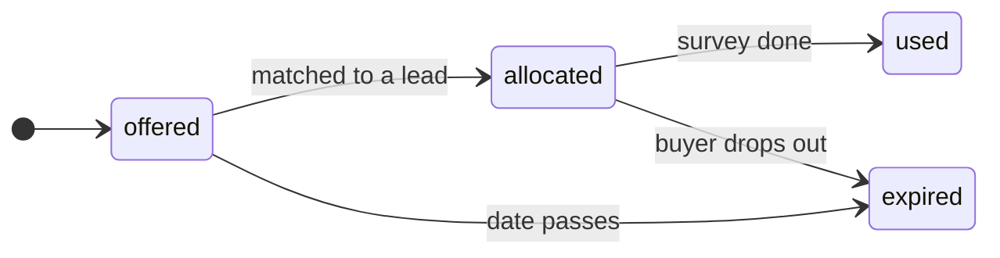
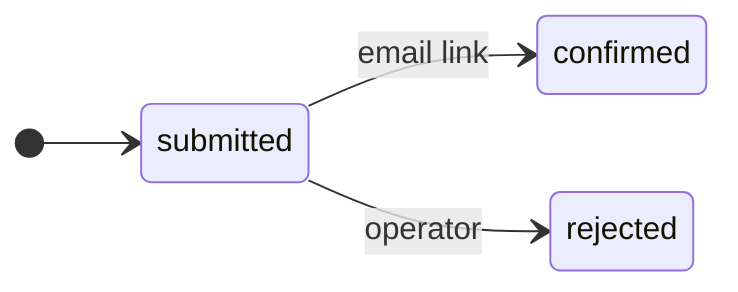
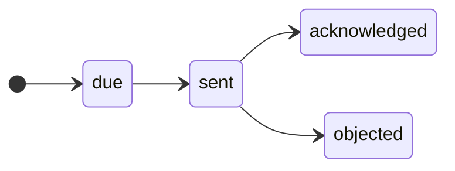

# The map (generated from `model/` by `npm run model:views`; do not edit)

Read top-down: **why** (D, PN) → **who** (P, CH, ALT) → **what** (U, ST) → **how** (PR, O) → code. Every line cites its D, R or Q.

## Why: decisions

| id | decision | said | rests on |
|---|---|---|---|
| D1 | Domain: a UK directory of planning-survey firms, built lean in its own repo | "callsheet is huge. like a cathedral. i want a porsche macan with snow treads baby (chose: New lean repo; All planning surveys)" (2026-10-23) | R0/S7, R0/S9, R0/S10 |
| D2 | Business model M1: firms pay per brief they unlock; every lead is qualified first | "yeah fuck it M1. we'll take in leads and qualify them. we'll build a qualification system." (2026-10-23) | R0/S10 |
| D3 | We work from models: map first, territory follows, map updated | "models are the map. we build the territory, and the maps are updated to reflect. it's a tight, closed, loop." (2026-10-23) | principal |
| D4 | Claims need receipts; a map is not evidence | "you have a bad habit of believing the the maps say i want cold hard receipts." (2026-10-23) | principal |
| D5 | Sell firms intelligence on where and when demand is coming | "4. okay, GOOD! LETS DO THAT TOO" (2026-10-23) | R2 |
| D6 | Firms can pay in kind with spare survey capacity | "5. GOOOD LETS DO THAT TOO" (2026-10-23) | R2 |
| D7 | Delegation demands evidence up front | "who the FUCK sends out their asisstants to do something and NOT ASK FOR EVIDENCE?" (2026-10-23) | R3 |
| D8 | A clear, traceable, business-driven information architecture; no bloat | "we need a clear hiearchal information architecture. traceable. clean, not stupid. business driven. i dont want it to bloat like the old callsheet." (2026-10-23) | principal |
| D9 | Threshold for M1, provisional: £100k a year at 5% capture | "threshold, yeah i guess. i dont know I DONT HAVE A FUCKING POINT OF REFERENCE YET DO I?" (2026-10-23) | R3, Q10 |
| D10 | Buyer pain points front and centre, synthesised, in design and in the model | "1. and on that note we need to hold those buyer pain points front and centre. but synthesized. add that to our design plans and model ideas." (2026-10-24) | R2, R4 |
| D11 | Business model first, then design around it for humans | "q12 yep - first we think about our business model then we design around it for humans." (2026-10-24) | R4 |
| D12 | Build the product now on the placeholder terms; the calls come later | "calls later. we build the product regardless. its not rocket science what we're building." (2026-10-24) | R6, Q15, Q16 |
| D13 | M1 at £99,417 a year (5% capture) is acceptable | "99,417 is acceptable" (2026-10-24) | R3, D9, Q10 |
| D14 | Show the journey on the site; problem first; answer before asking; say why for every detail; Mermaid now, brand skin later | "the user journey should be illustrated on the site. one annoyance from my point of view as a buyer is i dont know wtf im filling information for. they ask me for my name, why? my email and phone number, why?, address, why? what comes after? why cant i know now? why cant i say what my problem is first? its all annoying and backwardsa and breadcrumbed like im being tricked into a trap. can we like, use mermaid and later on stick on a visual skin tuned to our branding? (then, on the requirements read back: yes)" (2026-10-24) | D10, Q17 |
| D15 | Work management must survive sessions: nothing pending lives only in a chat; mirror the map to GitHub at the end of this session | "well do it at the end of this session. im concernw with our work management being lost and collapsing as sessions progress." (2026-10-24) | D3, D8 |
| D16 | Product first: park the legal work (privacy notice, listing notice, removal) until the loop is solid | "lets focus on the product. park all the legalese bullshit for after we got a solid loop" (2026-10-24) | A3 |
| D17 | A piece is done when a layman can use it without help; only the brand skin comes later. The buyer side is not there yet | "okay. FYI the buyer side is sorely lacking. it looks like coding genius that has no idea what another living person thinks about when going on online didit" (2026-10-24) | D10, D14 |
| D18 | Open the way people already know (trust headline, one plain question, proof, free, three steps), then open into what we've learned (normal? cost? time? season, follow-ons, one thing per screen) | "almost. start witht he conventional, then open into what we'e learned." (2026-10-24) | R7, D17, Q22 |
| D19 | Say how we're paid and what we check; show three plain steps on the site, Mermaid stays for the map | "(chose: Say how we're paid; Three plain steps)" (2026-10-24) | D2, D14, R7 |
| D20 | The quote journey shows a progress bar and, from the start, a checklist of everything we'll ask the buyer | "on UX. when i land here: http://localhost:3000/quote can we have a progress bar please, and a checklist of all we need from the burger" (2026-10-24) | D14, D17 |
| D21 | Home page order: the familiar headline, then 'Has the council asked you for a survey?', then how it works, then why to trust us | "lets tweak the homepage journey. first of all - this section  belongs higher up: Has the council asked you for a survey?. why do you think i say that? this one is second: How it works, and then the 3 card banner section" (2026-10-24) | R7, D18 |
| D22 | The buyer gets a private status link to keep and revisit; it ends when a firm takes the job, the buyer cancels, or it expires; we notify them as things change | "2 ok this one is cool: could we have a unique link generated that they can keep and revisit to check on status? it dies on a few options i can think of: firm buys the lead, buyer cancels, link expires? wed ask for their email and number so they get notified?" (2026-10-24) | R9 |
| D23 | A request drafter: a cheap language model reads what the buyer writes, shows the key facts as editable pills, and drafts the request the firm receives, live | "1, we would have to really show value, im thinking we develop a smart predctivie quote generator that reads what they write and drafts a proper request to the firm real time wed use a cheap llm, maybe one of the new decision models, and it would pick up keywords, place them as little pills that the user can edit or remove and the llm dynamically changes the response based on that.... and then we can say something like, look (for reasons i cant think of) you can see who wed contact, their website is shit and their contact form is pants, we will send this (message we've drafted) to them with other information that they need to qualify as fast as possible and save everyone the hassle - speed up the signing a real deal...? am i dreaming here? (then:) claude API + openrouter or cloudflare decision models (new type of models come out recently)" (2026-10-24) | R9, D14, Q26 |
| D24 | At most three firms per job, unless the buyer chooses a bigger pool | "4 yeah at most three firms unless they want a bigger pool at their discretion?" (2026-10-24) | R9, Q15 |
| D25 | Free for firms at first, to get the first firms on board; charge once they're happy and we have standing | "(and, choosing pool size:) 5 or 10 or all that cover the area - up to the buyer. firm side. for now lets do free and get our first firms onboarded, when theyre happy and we got clout we can say look - we make everyones life easy, what would it cost for you to do this yourself? guess what you can do what youre good at and we only want this much, win for you, the buyer and us(me and you, claude)." (2026-10-24) | D2, Q16, Q25 |
| D26 | The status link shows the final state after a firm takes the job; email updates now, texts later; research the model options before building the drafter | "(chose: Show the final state; Email now, text later; Research, then compare)" (2026-10-24) | D22, D23, Q26 |
| D27 | Firms get a standard job sheet plus a trimmed excerpt of the buyer's words, not a drafted story; fields come from survey standards and firms' own quote forms | "hmmm maybe the experience needs to be different. traditionally what does the firm see vs what we are trying to innovate here? because a buyer saying "x y z quoted £nnn" isnt helping anyone. (then:) run R12, sheet plus trimmed excerpt < on the fields a surveyor needs to price a job - surely theres some sort of standard to start from?" (2026-10-24) | R9, R11, Q11, Q27 |
| D28 | Show the buyer the request firms will get, beside every step, filling in live as they type and answer; the pills are its editable rows | "right. ask yourself.... because right now i dont know what im looking at. (then, on the proposed panel:) lets see what it looks like. go" (2026-10-24) | D23, D27, D17 |
| D29 | Keep the familiar form parts (checklist ticks, the step-by-step questions); read the work type and planning stage from the buyer's words too, pre-filled for them to confirm | "very close. i think you threw the baby out with the bathwater though. this looks good but there needs to be some traditional parts still present. yep pull the work type and planning stage from the words too" (2026-10-24) | D28, D20 |
| D30 | Every checklist row can be clicked to fill it in or change it; no repeated filler text; 'Something else' can be described | "they should be able to click on the checklist items to fill in at the end. also "we'll ask" as a filler repeated over and over like that is confusing and slightly annoying to look at? (then:) agreed. and on "other" options such as 'what are you planning?' > something else. theres no way to describe it?" (2026-10-24) | D28, D20 |
| D31 | The first screen says plainly that our AI reads what they write to make the most helpful request: what helps, ticked live; what the AI does and doesn't; honest when it isn't running; the provider isn't named | "maybe we can have the in your own words a bit more fleshed out, so that they can understand we're using modern tech (ai) to help them with the most helpful request? (then, on the proposed requirements:) 1. agreed. 2. yep 3. sure 4. not that important i think at this point in their journey. 5. yes 6. yes." (2026-10-24) | D23, D17, Q29 |
| D32 | Ask about the building in everyday words with examples, not its 'type' | "im not sure people would know what "type" of building their house is. maybe. but type os vague?" (2026-10-24) | D17, R12 |

## Why: buyer pains (D10)

What buyers suffer today, synthesised from the sources; every design answers one of these.

| id | pain | sources | receipt | answered by |
|---|---|---|---|---|
| PN1 | A cheap first survey led to a large or doubtful follow-on bill | 14 (About 10 of the 14 are one national firm's reviews) | £1,306.80 first survey, then a £28,726.80 follow-on quote; an independent did it for £3,924 (R2) | Q4 |
| PN2 | The season cost me months, or a year | 8 | 'wait a year'; the 12-month wait used as a sales lever (R2) | U1, ST-U2.2, Q5 |
| PN3 | I can't find or hear back from a surveyor, or tell why they want my details and what happens next | 9 (The details-and-next-step half has one source, the principal; Q17 tests it) | 'the planning officer doesn't recommend anyone, so I'm at the mercy of Google' (R2); the professional body's directory leaves the buyer to contact practices one by one (R4); 'they ask me for my name, why? ... what comes after?' (the principal as a buyer, D14) | ST-U2.1, ST-U2.2, ST-U2.3, PR2, Q7, Q11, Q17 |
| PN4 | I found out at validation that I needed a survey | 7 | 'Only to be told I needed a bat survey' (R2) | U1, CH-validation, Q6 |
| PN5 | I didn't know whose report the council would accept | 4 | 'ask the council who they accept surveys from' (R2) | Q14 |

Aims on the boundary: A1 Earn money from firms (M1, plus intelligence and in-kind); A2 Grow and keep a correct list of firms; A3 Stay lawful: listing notices, removal, retention.

## Who: context

System of interest: **The directory** (the service, the operator (the principal)). It is what we build and run.

### Channels

| id | party | channel | status | receipt | rests on |
|---|---|---|---|---|---|
| CH-search | Buyers (homeowners, small developers) | Searches the survey the council asked for | part | 'bat survey', 'flood risk assessment', 'environmental impact assessment' each 1K-10K UK searches a month (S7); Arbtech in 14 of 23 searches (R1) | R0/S7, R1 |
| CH-validation | Buyers (homeowners, small developers) | Told by the council at validation that a survey is missing | missing | 'Only to be told I needed a bat survey'; 'the planning officer doesn't recommend anyone, so I'm at the mercy of Google' (R2 gap-buyer.md) | R2 |
| CH-agent | Agents (architects, planning consultants) | Architects and planning consultants pick or recommend the firm *(guess)* | missing | none yet | Q1 |
| CH-outbound | Survey firms | We find and contact firms from Companies House and their sites | part | 82% of CIEEM practices are active companies, 67% with SIC 74901; R3's rule kept 35% (micro-entity and age filters); no rule tested reaches 70% recall at a workable size (R5) | R0/S9, R3, R4, R5 |
| CH-body | Survey firms | Professional bodies' directories (CIEEM, ANC) | outside | CIEEM Registered Practice Directory: 169 UK practices, 145 offering a catalogue ecology survey, 134 bat surveys; firms pay £147-£3,140+VAT a year by headcount (R4) | R1, R4 |
| CH-peers | Survey firms | Firms pass overflow work to each other *(guess)* | missing | none yet | Q8 |

### Alternatives

| id | alternative | serves | offer | rests on |
|---|---|---|---|---|
| ALT-arbtech | Arbtech (national firm) | U1, U2 | Fixed published prices (bat roost £399+VAT), UK coverage, money-back guarantee; in 14 of 23 searches; also runs batsurveys.co.uk, ecologysurveys.uk, biodiversitynetgainplan.co.uk Receipt: Arbtech Consulting Ltd (05678552) accounts to 23 Sep 2024: turnover £10,841,715, profit before tax £4,483,055, 113 staff, 'over 13,800' assessments; 60% acquired by Celnor Group | R1, R2 |
| ALT-signed-off | Signed Off (signed-off.co.uk) | U1, U2, U5 | 'Which reports do I need?' checker (no postcode or council step), directory, quotes from up to 3; free and paid listings | R2 |
| ALT-planning-review | The Planning Review | U2 | Firms found on planning applications, with quotes; no checker | R2 |
| ALT-cieem | CIEEM Registered Practices Directory | U2, U5 | Search by postcode and distance, then filter by service, species and licence; contact each practice yourself (no enquiry form, no prices, no season); ecology only; firms pay £147-£3,140+VAT a year Receipt: 169 UK practices; within 25 miles: Bristol 22, London 18, Glasgow 12, Edinburgh 7, Belfast 1 (R4) | R1, R4 |
| ALT-worklanded | Worklanded | U4 | Bat and ecology leads sold to firms at £26 each, one firm at a time; 11 enquiries in 90 days | R1 |
| ALT-brokers | Small brokers (batsurveycost.co.uk, RenKap, Yell) | U2 | Pass one request to up to 3 firms; firm-side terms not published | R1 |

## What: use cases

| id | party | use case | status | rests on |
|---|---|---|---|---|
| U1 | Buyers (homeowners, small developers) | Find out which survey I need, and when it can be done | built | R2 |
| U2 | Buyers (homeowners, small developers) | Get the survey done in time for my application | part | D2, R3 |
| U3 | Agents (architects, planning consultants) | Get several surveys quoted for one site, quickly *(guess)* | missing | Q1 |
| U4 | Survey firms | Get the enquiries I want, and not the ones I don't | part | D2, Q2, Q3 |
| U5 | Survey firms | Keep my listing right, or have it removed | part | D1 |
| U6 | Survey firms | Know where and when demand is coming, so I can plan my season | missing | D5, D6 |

### Stages

**U2** Get the survey done in time for my application

| id | stage | outcome | status |
|---|---|---|---|
| ST-U2.1 | Tell us what's going on | The problem in my own words, and where the site is | built |
| ST-U2.2 | Find out what you need and when | Knows the survey, its season, a typical price and how many firms cover the area | built |
| ST-U2.3 | Choose whether to get quotes | Contact given knowing why; confirmed, checked and sent to up to 3 firms | built |
| ST-U2.4 | Pick a firm and book | A firm is booked | outside |
| ST-U2.5 | The survey and the report | Has the report for the council | outside |

**U4** Get the enquiries I want, and not the ones I don't

| id | stage | outcome | status |
|---|---|---|---|
| ST-U4.1 | Be found | Listed, claimed or not | built |
| ST-U4.2 | Get a brief | Sees survey, area, deadline, site; contact hidden | built |
| ST-U4.3 | Decide | Unlocked (pays) or passed; paused when booked up | part |
| ST-U4.4 | Quote | Buyer has the firm's quote | outside |
| ST-U4.5 | Win or lose | We know the outcome | part |

## How: objects

### O-lead Lead (part; rests on D2)

```mermaid
stateDiagram-v2
  direction LR
  [*] --> received
  received --> awaiting_confirmation: graded at intake
  received --> needs_info: graded at intake
  received --> not_a_fit: graded at intake
  awaiting_confirmation --> qualified: buyer confirms
  awaiting_confirmation --> needs_info: buyer confirms
  needs_info --> qualified: buyer adds details
  qualified --> approved: operator
  qualified --> rejected: operator
  needs_info --> rejected: operator
  not_a_fit --> rejected: operator
  awaiting_confirmation --> rejected: operator
  approved --> offered: routing - briefs sent
  approved --> expired: routing - no firm matches
  offered --> closed: a firm unlocks, none still deciding
  offered --> expired: every brief declined or lapsed
  awaiting_confirmation --> cancelled: buyer cancels (D22)
  qualified --> cancelled: buyer cancels (D22)
  approved --> cancelled: buyer cancels (D22)
  offered --> cancelled: buyer cancels; open briefs are withdrawn (D22)
```

### O-brief Brief (one lead offered to one firm) (part; rests on D2, Q3)

### O-listing Listing (a firm) (part; rests on D1)

### O-slot Slot (spare survey capacity, paid in kind) (missing; rests on D6)

### O-claim Claim (part; rests on D1)

### O-notice Notice (Article 14, to a listed firm) (missing; rests on D1)

## How: processes

| id | process | realises | steps | status | rests on |
|---|---|---|---|---|---|
| PR1 | Qualify a lead | U2 | Buyers (homeowners, small developers): Say the problem; see the answer; choose to send, giving contact last (built); The directory: Read the buyer's words as they type into pills, saying plainly that our AI does it, what helps and what it does and doesn't; work type and planning stage pre-fill their questions to confirm (D23, D29, D31, D32) (built); Buyers (homeowners, small developers): See the request firms will get beside every step: checklist ticks, each row goes to its question and back, pills changed or removed in place (D28, D29, D30) (built); Buyers (homeowners, small developers): Answer only the survey's missing questions, one per screen, each with 'not sure'; describe 'something else' (R12, D30, Q28) (built); The directory: Send firms the job sheet plus a trimmed excerpt: prices, other firms' quotes and contact details left out (D27, Q27) (built); Buyers (homeowners, small developers): Add drawings or photos for the firm (asked for by 4 of 15 firms' forms, R12) (missing); The directory: Test the AI's reading on the R10 and R11 inputs, pre-registered, before relying on it (Q29) (missing); The directory: Work out the area and the council from the postcode, so the buyer isn't asked twice (built); The directory: Grade on real, serious, timely, complete (built); Buyers (homeowners, small developers): Confirm by email (button press); no mail provider in production yet (Q21) (built); The directory: Operator approves or rejects (built); The directory: Tell buyers, in a privacy notice, what we keep, who sees it, the outside services (postcode lookup, AI reader) and how long we keep it (parked, D16) (missing) | part | D2, D14, D23, D27, D28, D29, D30, D31, D32, R12, Q26, Q28, Q29 |
| PR2 | Route a lead | U4 | The directory: Match firms by survey, region, availability (built); The directory: Offer briefs, contact hidden (built); Survey firms: Unlock (fee owed) or pass; pause when booked up (built); The directory: Chase firms once, halfway through their time; lapse and tell the buyer (built); Survey firms: Record that they quoted, then whether they won or lost (built); Buyers (homeowners, small developers): Keep a private status link, emailed as things change; after a firm takes the job it shows the final state; it stops on cancelling or expiry (D22, D26) (built); Buyers (homeowners, small developers): Choose a bigger pool than three firms if they want: 5, 10 or every firm that covers the area (D24) (built); The directory: Free for firms at first; the fee is set to nothing until firms are happy (D25) (built); The directory: Ask the buyer whether they booked a survey (missing) | part | D2, D12, D22, D24, D25, D26, Q3, Q15, Q16 |
| PR3 | Claim a listing | U5 | Survey firms: Claim with an email on the firm's domain (built); The directory: Email a confirmation link (built); Survey firms: Edit the listing (missing) | part | D1 |
| PR4 | Add firms | U5 | The directory: Check candidates exist and are active in vein (Companies House) (missing); The directory: Take candidates from CIEEM's Registered Practice Directory (145 ecology practices), once CIEEM gives written permission (missing); The directory: Check the site sells planning surveys (part); The directory: Map surveys and regions (part); The directory: Send the listing notice (parked, D16) (missing) | part | R0/S9, R3, R4, R5 |
| PR5 | Correct or remove a listing | U5 | Survey firms: Ask (missing); The directory: Apply and tombstone (missing) | missing | D1, D16 |
