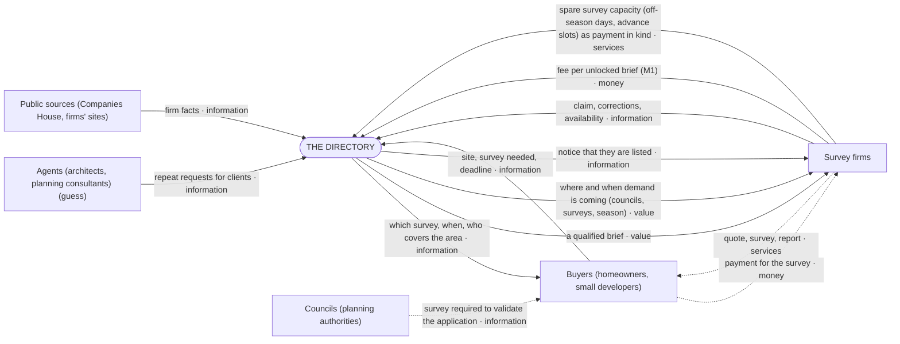
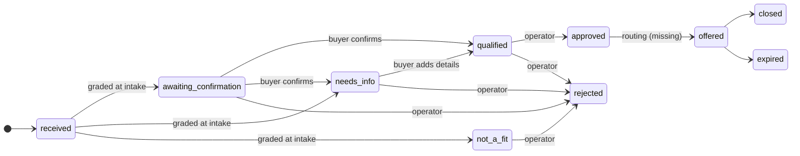
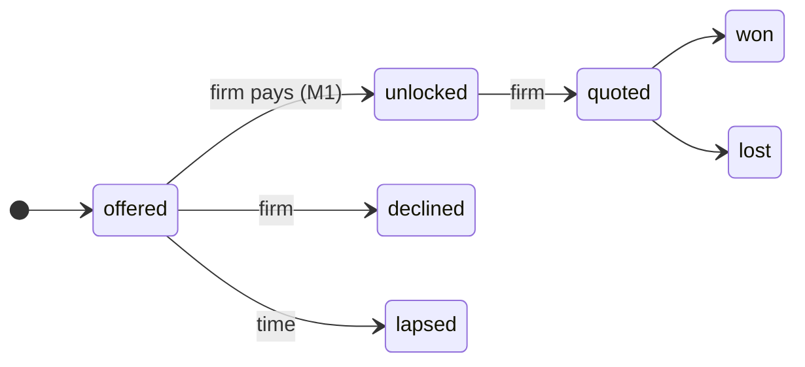
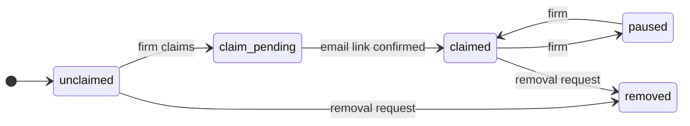
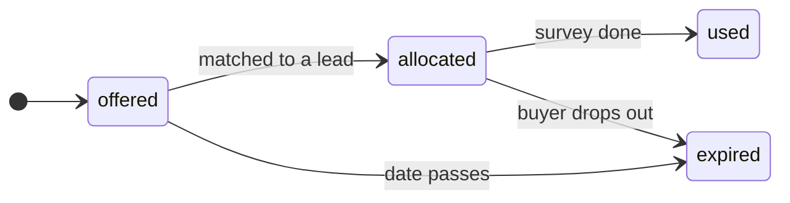
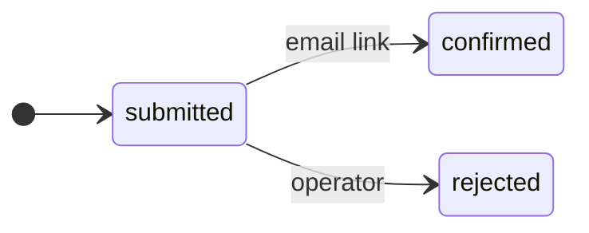
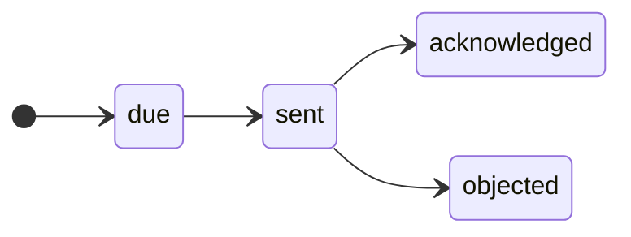

# The map (generated from `model/` by `npm run model:views`; do not edit)

## Decisions

- **M1** (2026-10-23): Firms pay per brief they unlock; every lead is qualified first. *"yeah fuck it M1. we'll take in leads and qualify them. we'll build a qualification system."*

- **models** (2026-10-23): We work from models: map first, territory follows, map updated. *"models are the map. we build the territory, and the maps are updated to reflect. it's a tight, closed, loop."*

- **receipts** (2026-10-23): Claims need receipts; a map is not evidence. *"you have a bad habit of believing the the maps say i want cold hard receipts."*

- **intel** (2026-10-23): Sell firms intelligence on where and when demand is coming (U6). *"4. okay, GOOD! LETS DO THAT TOO"*

- **in-kind** (2026-10-23): Firms can pay in kind with spare survey capacity. *"5. GOOOD LETS DO THAT TOO"*

## Level 0: context

System of interest: **The directory**: It is what we build and run.

Aims on the boundary: Earn money (M1); Grow and keep a correct list of firms; Stay lawful: listing notices, removal, retention.

## Channels (how each party reaches us)

| party | channel | kind | status | receipt |
|---|---|---|---|---|
| Buyers (homeowners, small developers) | Searches the survey the council asked for | search | part | S7: 'bat survey', 'flood risk assessment', 'environmental impact assessment' each 1K-10K UK searches/month (Keyword Planner, callsheet docs/screens/s7-env-buyer-demand/result.md) |
| Buyers (homeowners, small developers) | Told by the council at validation that a survey is missing | moment | missing | C2 buyer quotes: 'Only to be told I needed a bat survey'; 'the planning officer doesn't recommend anyone, so I'm at the mercy of Google' (docs/research/c2-gaps/evidence/gap-buyer.md) |
| Agents (architects, planning consultants) | Architects and planning consultants pick or recommend the firm *(guess)* | referral | missing | none yet |
| Survey firms | We find and contact firms from Companies House and their sites | outbound | part | S9: ~230-410 survey sellers with a website in SIC 74901; 15 called-list firms checked live (vein, D:/data/vein/out/s8/ch-check.json) |
| Survey firms | Professional bodies' directories (CIEEM, ANC) | body | outside | CIEEM Registered Practices Directory, firms pay £147-£368+VAT a year (C1 evidence/c1-partB.md) |
| Survey firms | Firms pass overflow work to each other *(guess)* | community | missing | none yet |

## Level 1: use cases

| id | party | use case | status |
|---|---|---|---|
| U1 | Buyers (homeowners, small developers) | Find out which survey I need, and when it can be done | built |
| U2 | Buyers (homeowners, small developers) | Get the survey done in time for my application | part |
| U3 | Agents (architects, planning consultants) | Get several surveys quoted for one site, quickly *(guess)* | missing |
| U4 | Survey firms | Get the enquiries I want, and not the ones I don't | missing |
| U6 | Survey firms | Know where and when demand is coming, so I can plan my season | missing |
| U5 | Survey firms | Keep my listing right, or have it removed | part |

## Level 2: stages

### U2 Get the survey done in time for my application

| stage | outcome | status |
|---|---|---|
| U2.1 Learn what's needed | Knows the survey and its season | built |
| U2.2 Find who covers it | Has firms for the survey and region | built |
| U2.3 Ask once | Request described, confirmed and qualified | part |
| U2.4 Choose and book | A firm is booked | outside |
| U2.5 Survey and report | Has the report for the council | outside |

### U4 Get the enquiries I want, and not the ones I don't

| stage | outcome | status |
|---|---|---|
| U4.1 Be found | Listed, claimed or not | built |
| U4.2 Get a brief | Sees survey, area, deadline, site; contact hidden | missing |
| U4.3 Decide | Unlocked (pays) or passed; paused when booked up | missing |
| U4.4 Quote | Buyer has the firm's quote | outside |
| U4.5 Win or lose | We know the outcome | missing |

## Objects

### Lead (part)

### Brief (one lead offered to one firm) (missing)

### Listing (a firm) (part)

### Slot (a firm's spare survey capacity, offered as payment in kind) (missing)

### Claim (part)

### Notice (Article 14, to a listed firm) (missing)

## Alternatives (what parties use instead of us)

| alternative | kind | serves | offer |
|---|---|---|---|
| Arbtech (national firm) | firm | U1, U2 | Fixed published prices (bat roost £399+VAT), UK coverage, planning money-back guarantee; in 14 of 23 searches Receipt: Arbtech Consulting Ltd (05678552) full accounts, year to 23 Sep 2024: turnover £10,841,715 (2023: £8,369,093), profit before tax £4,483,055, 113 staff, 'over 13,800' assessments and planning submissions; '60% acquired by private equity backed Celnor Group' (Companies House filing MzQ3MTUwNzU3MGFkaXF6a2N4) |
| Arbtech's keyword sites (batsurveys.co.uk, ecologysurveys.uk, biodiversitynetgainplan.co.uk) | firm | U2 | Run by Arbtech Consulting Ltd (named in each privacy policy); #1 for 'bat survey near me'; 'from £' prices |
| Signed Off (signed-off.co.uk) | directory | U1, U2, U5 | 'Which reports do I need?' checker (no postcode or council step), directory (75 ecologists), quotes from up to 3; free and paid featured listings; operator incorporated Nov 2024 |
| The Planning Review | directory | U2 | Lists firms found on planning applications, with quotes; no checker; operator not named |
| CIEEM Registered Practices Directory | directory | U2, U5 | Search by service and postcode; firms pay £147–£368+VAT a year through membership |
| Worklanded | marketplace | U4 | Bat and ecology leads sold to firms at £26 each, one firm at a time; 11 enquiries in 90 days |
| Small brokers (batsurveycost.co.uk, RenKap, Yell enquiries) | broker | U2 | Pass one request to up to 3 firms; firm-side terms not published |

## Level 3: processes

```mermaid
flowchart TD
  subgraph P1["P1 Qualify a lead · built"]
    P1_0["Buyers (homeowners, small developers): Describe the site and the need"]:::built
    P1_1["The directory: Grade on real, serious, timely, complete"]:::built
    P1_2["Buyers (homeowners, small developers): Confirm by email (button press)"]:::built
    P1_3["The directory: Operator approves or rejects"]:::built
    P1_0 --> P1_1
    P1_1 --> P1_2
    P1_2 --> P1_3
  end
  subgraph P2["P2 Route a lead · missing"]
    P2_0["The directory: Match firms by survey, region, availability"]:::missing
    P2_1["The directory: Offer briefs, contact hidden"]:::missing
    P2_2["Survey firms: Unlock (pay) or pass"]:::missing
    P2_3["The directory: Chase or lapse; tell the buyer"]:::missing
    P2_0 --> P2_1
    P2_1 --> P2_2
    P2_2 --> P2_3
  end
  subgraph P3["P3 Claim a listing · part"]
    P3_0["Survey firms: Claim with an email on the firm's domain"]:::built
    P3_1["The directory: Email a confirmation link"]:::missing
    P3_2["Survey firms: Edit the listing"]:::missing
    P3_0 --> P3_1
    P3_1 --> P3_2
  end
  subgraph P4["P4 Add firms · part"]
    P4_0["The directory: Take candidates from vein"]:::missing
    P4_1["The directory: Check the site sells planning surveys"]:::part
    P4_2["The directory: Map surveys and regions"]:::part
    P4_3["The directory: Send the listing notice"]:::missing
    P4_0 --> P4_1
    P4_1 --> P4_2
    P4_2 --> P4_3
  end
  subgraph P5["P5 Correct or remove a listing · missing"]
    P5_0["Survey firms: Ask"]:::missing
    P5_1["The directory: Apply and tombstone"]:::missing
    P5_0 --> P5_1
  end
  classDef built fill:#e3eee7,stroke:#2f5d46
  classDef part fill:#f7eedd,stroke:#9a6512
  classDef missing fill:#f6e3df,stroke:#a23b2a
  classDef outside fill:none,stroke-dasharray:4 3
```

